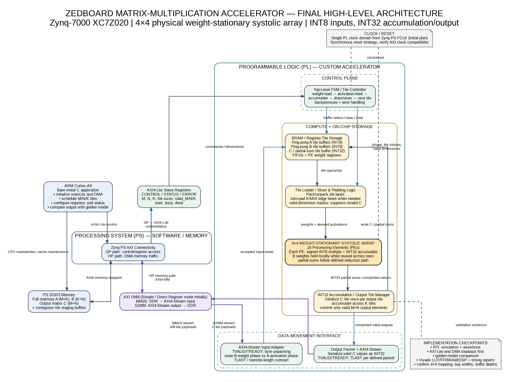

# Design and FPGA Implementation of an INT8 Weight-Stationary Systolic Array Accelerator for Matrix Multiplication on Zynq-7000

A 4×4 weight-stationary systolic array accelerator for matrix multiplication using INT8 operands and INT32 accumulation, targeting the ZedBoard (Zynq-7000 / XC7Z020).

The project includes a C++ golden reference model, SystemVerilog RTL design, UVM-based verification, AXI interfaces, double-buffered BRAM, and FPGA implementation.

## Architecture

